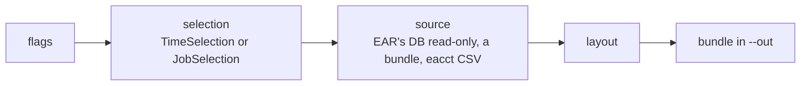

# ear-db-export

Reads the data EAR collects (node metrics, jobs, power and application
signatures, loops, events) from its database and writes it to files, without
ever writing to the database. One command, `export LAYOUT`, where the layout
says what to write:

| Layout | Writes one row per | Reads |
|---|---|---|
| `raw` | table row, **as stored**: whole tables, or the rows the filters pick and every row they point to | the tables named (default all) |
| `node_metrics` | node, interval and metric (long format) | `Periodic_metrics` |
| `job_nodes` | job step and node it ran on | `Jobs`, `Applications` |
| `power_signatures` | job step and node, with EARD's power signature | … and `Power_signatures` |
| `eacct` | job step and node, as `eacct -l -c` writes it | … `Signatures`, `GPU_signatures` |

Each output is a *bundle*: the files, `SHA256SUMS`, `manifest.json` and, when
the run has a time window, `checkpoint.json`. `check` compares the database
with the schema profile and shows the account's grants.



Each layout takes only the filters that apply to it: dates (`--from/--to`),
nodes (`--nodes` hostlist, `--tags` from ear.conf) and, for the job layouts,
`--jobs 123,456.0,1000-2000,789.sb --users --accounts --groups --apps --etags
--policies --batch-steps --limit`. `ear-db-export export LAYOUT --help` lists
them. User names, accounts and groups are pseudonymised (HMAC with your secret
salt) before anything is written.

It connects with EAR's read-only `DBCommandsUser` from `ear.conf`, in a
read-only session, and reads EAR 4.3, 5.x, 6.x and 7 (schema profiles
`ear4`, `ear6`, `ear7`, autodetected); `export raw` without filters needs no
profile, so any version can be exported whole.

## Install

Needs Python ≥ 3.9 and [uv](https://docs.astral.sh/uv/).

```bash
uv tool install git+https://github.com/eas4dc/ear-db-exporter@v0.6.0   # puts `ear-db-export` on PATH
# or from a checkout:
uv tool install /path/to/ear-db-exporter
```

Offline installs (wheels) are described in the user guide.

## Quick start

```bash
umask 077; head -c 32 /dev/urandom | base64 > /etc/ear-db-export/salt   # once; keep it forever
S="--salt-file /etc/ear-db-export/salt"

ear-db-export check                                                       # exit 0 = schema profile matches
ear-db-export export raw --out /data/ear-dump $S                         # the whole database, as stored
ear-db-export export raw --users alice --from 2026-09-01 --to 2026-09-30 --dry-run --out /tmp/x   # queries + EXPLAIN
ear-db-export export node_metrics --service mycluster --hive --resume --from 2026-10-01 \
    --to "$(date -u -d '2 days ago' +%F)" --out /data/ear/node_metrics $S  # daily, from cron
ear-db-export export eacct --as csv --jobs 123456 --out /tmp/job $S       # eacct's CSV layout
ear-db-export export power_signatures --bundle /data/ear-dump --out /tmp/ps   # from a bundle
```

The tool does not schedule anything: a cron job runs it with `--resume`, which
continues after the last window the bundle received. EAR prunes
`Periodic_metrics` (about every 2 months by default), so the daily run must
not stop for long: missed days are lost.

## Basic usage

```
ear-db-export check [--conf | --db-*] [--profile]
ear-db-export export LAYOUT [layout flags] [source] [output]
```

Every flag of a layout: `ear-db-export export LAYOUT --help`, or the user
guide. Flags can also come from a file, one per line (`@FILE`).

Exit codes: `0` ok, `1` runtime error (DB, I/O), `2` configuration or schema
error. Upgrading from 0.4.0: `CHANGELOG.md` maps the old commands to the new ones.

## Documentation

The full documentation has the user guide (layouts, filters, bundles, cron,
sending an extract, offline install), **the data** (every column with its
unit, for readers who don't know EAR), **what the tool does to your database**
(account, queries, what leaves the site, personal data), the architecture, the
reference and the Python API. Build it and open it in a browser:

```bash
uv run --group docs sphinx-build -W -E -b html docs docs/_build/html
xdg-open docs/_build/html/index.html
```

Reading the code? Start at `src/ear_db_export/layouts/` (one pipeline per
layout, with its flow as a diagram in the docstring), then `selection/` (what
each filter means) and `read/` (the sources). `read/sql/mariadb.py` is the
only file that runs SQL.

## slurm-db-export

The same package installs `slurm-db-export`, which reads Slurm's accounting
database (slurmdbd's `slurm_acct_db`) read-only. It writes the job, step, event
and reservation tables per cluster and month (`export raw`), and one decoded row
per job (`export jobs`: TRES columns, state names, wait and run times), to train
scheduling models. It covers Slurm 17.11 to 25.05.

```bash
D="--db-host slurmmaster --db-user RO_USER --db-password-file /etc/slurm-db-export/pw"
slurm-db-export check $D
slurm-db-export export raw $D --cluster lenox.hu --from 2026-09-01 --to 2026-10-13 \
    --salt-file /etc/slurm-db-export/salt --out /data/slurm/raw
slurm-db-export export jobs --bundle /data/slurm/raw --out /data/slurm/jobs
```

Everything else is in the documentation's *Slurm accounting* page (`docs/slurm.md`):
- the account to create, and the cron re-export;
- what it does to slurmdbd, and what is pseudonymised;
- Slurm versions, every column, and what is out of scope.

## Development

```bash
uv sync
uv run pytest                                                     # unit tests, no DB (SQLite fake)
EAR_EXPORT_TEST_CONF=$EAR_ETC/ear/ear.conf uv run pytest -m db    # integration, read-only
SLURM_EXPORT_TEST_ARGS="--db-host H --db-user U --db-password-file F" \
    SLURM_EXPORT_TEST_CLUSTER=lenox.hu uv run pytest -m db tests/test_slurm_live.py
```
