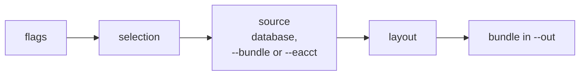

# User guide

`ear-db-export` reads the data EAR collects (node metrics, jobs, power and
application signatures, loops, events) out of EAR's database and writes it to
files. One command, `export LAYOUT`, where the *layout* says what to write:

```{layouts}
```

`raw` is for back-ups, moving or archiving a database and sending a subset of
it; the other layouts are clean tables for analysis: node power and energy over
time, who ran where and when, the power of every job, and eacct's own files.

It only reads: no writes to the database, no temporary tables, no indexes
added ({doc}`audit` has the details and how to check them). It writes only to
an output directory (`--out`). Copying the files elsewhere (S3, a data lake,
another site) is a separate step you own. What the files hold: {doc}`data`.

## How a run works



| Step | What happens | Example (`export node_metrics`, one day) |
|---|---|---|
| Select | The layout's flags become a selection: time-series rows by time and node, or job steps by `Jobs` columns | `--from 2026-07-04 --to 2026-07-04` |
| Read | The source reads page by page (time series) or 5000 job steps at a time, following EAR's links | 14 071 `Periodic_metrics` rows |
| Shape | The layout cleans and shapes each batch | 77 391 rows, one per node, minute and metric |
| Write | Files at `--path` in `--out`, then `SHA256SUMS`, `checkpoint.json`, `manifest.json` | `OUT/node_metrics.parquet` |

## The source: EAR's database, a bundle, or eacct files

EAR stores its data in MariaDB/MySQL; this is the engine the tool ships.

- **Connection from ear.conf** (`--conf`, default `$EAR_ETC/ear/ear.conf`,
  else `/etc/ear/ear.conf`): `DBIp`, `DBPort`, `DBDatabase`, and the
  **read-only** `DBCommandsUser` / `DBCommandsPassw` (never `DBUser`). They
  are read exactly as EAR reads them, so the tool connects where `eacct`
  connects. The `Island=` lines give each node its tag (`node_tag`, `--tags`).
  The password is never logged.
- **Or explicit flags:** give **all** of `--db-host --db-port --db-name
  --db-user --db-password-file`. Then ear.conf is not used for the
  connection; pass `--conf` too if you want node tags.
- **Or a bundle:** `--bundle DIR` reads a bundle written by `export raw`, with
  the same filters: layouts of data a site sent, a smaller extract of a bigger one.
  Node tags come from the bundle's manifest, or from `--conf` if given.
- **Or eacct files:** `--eacct FILE` (repeatable) reads `eacct -l -c` CSV files
  of eacct 5, 6 or 7, for the job layouts (`job_nodes`, `power_signatures`,
  `eacct`). Rows get new ids, and only the epoch `*_TIME` columns are read
  (eacct's `*_DATE` are in local time).
- The session is set to `READ ONLY`, so a write fails even if the account could write.

**Schema profiles.** EAR versions name some columns differently (EAR 7
renamed most). A profile maps the names the tool uses to the names of one EAR
version: `ear4` (EAR 4.3), `ear6` (EAR 5.0 – 6.x) or `ear7` (EAR 7). It is
autodetected, or forced with `--profile NAME` (or `--profile FILE.toml`, a
profile of your own). `ear-db-export check` compares it
with the database and exits `2` on a mismatch. Every layout needs a matching
profile, except `raw` without filters, so any EAR version can be dumped whole.

## Filters

Each layout takes only the filters that apply to it; `export LAYOUT --help`
lists them, and a flag a layout does not take is an error. Different flags
combine with AND, the values of one flag with OR (`--users a,b --apps 'lmp*'`
is "user a or b, and an application starting with lmp").

| Flag | Selects | Layouts |
|---|---|---|
| `--from DATE --to DATE` | rows whose time is in the window: `YYYY-MM-DD` is a whole UTC day (`--to` included), `YYYY-MM-DDTHH:MM[:SS]` an exact UTC time (`--to` excluded). Job steps are in the window they **ended** in. `--to` cannot be in the future | all |
| `--resume` | start where the last run into `--out` ended (its checkpoint); `--from` is only the first run's start. Needs `--to` | all |
| `--nodes` | nodes, as a Slurm hostlist: `--nodes 'cpu[001-064],gpu01'` | all |
| `--tags` | the nodes of these ear.conf `Island` tags: `--tags gpu` | all |
| `--jobs` | job ids, in `eacct -j` syntax plus ranges: `123,456.0,1000-2000,789.sb` (`.0` a step, `.sb` the batch step) | `raw`, `power_signatures`, `eacct` |
| `--users --accounts --groups` | users, Slurm accounts, Unix groups (comma-separated) | same |
| `--apps` | application names, with `*` and `?` wildcards: `--apps 'lmp*,python'` | same |
| `--etags --policies` | energy tags, EAR policies | same |
| `--batch-steps` | job granularity: only each job's batch step. Jobs launched with `srun` alone have no batch step and are left out | same |
| `--limit N` | the newest N job steps, by end time (eacct's `-n` counts jobs). Applied in the query, before `--nodes`: with `--nodes` you may get fewer | same |

On a pseudonymised bundle, give user filters as pseudonyms.

### Flags of each layout

The `--help` of each layout, as the tool prints it:

````{dropdown} export raw
```{export-help} raw
```
````

````{dropdown} export node_metrics
```{export-help} node_metrics
```
````

````{dropdown} export job_nodes
```{export-help} job_nodes
```
````

````{dropdown} export power_signatures
```{export-help} power_signatures
```
````

````{dropdown} export eacct
```{export-help} eacct
```
````

## Layouts

```bash
ear-db-export check
ear-db-export export raw --out /data/ear-dump --salt-file /etc/ear-db-export/salt
ear-db-export export raw --users alice --from 2026-09-01 --to 2026-09-30 --out /data/alice-sep --salt-file …
ear-db-export export node_metrics --service mycluster --from 2026-09-01 --to 2026-09-30 --hive --out /data/nm --salt-file …
ear-db-export export job_nodes --from 2026-09-01 --to 2026-09-30 --tags gpu --out /data/jn --salt-file …
ear-db-export export power_signatures --batch-steps --from 2026-09-01 --to 2026-09-30 --out /data/ps --salt-file …
ear-db-export export eacct --as csv --jobs 123456 --out /tmp/job --salt-file …
ear-db-export export power_signatures --bundle /data/site-x --out /tmp/site-x
```

Flags go after the layout. Exit codes: `0` ok, `1` runtime error (DB, I/O),
`2` configuration or schema error. Logs go to stdout (UTC timestamps) and end
with a summary of the files written. Flags can also come from a file, one per
line: `ear-db-export export node_metrics @/etc/ear-db-export/daily.args`
(lines like `--out=/data/ear`).

### `raw`: the tables as stored

```
OUT/manifest.json      # what, from where, how: written last, so a bundle without it is incomplete
OUT/SHA256SUMS         # checksums of every file: sha256sum -c SHA256SUMS
OUT/schema.sql         # the CREATE TABLE statements, as the server prints them
OUT/Jobs.parquet       # one file per table, every column, EAR's own names and exact types
OUT/Periodic_metrics.parquet
…
```

- **Without filters**, every table named (default all) is copied whole.
- **With filters** it is a *linked dump*: the job steps the filters pick, and
  every row they point to (applications, signatures, GPU signatures, loops);
  the time-series tables by their own time in the window, or, with job
  filters, the rows of the selected jobs over their time span. `Learning_*`
  tables are only included when named, and then whole.
- Without job filters, consecutive windows split the database without gaps
  or repeats, so a monthly archive is one run per month (`--path
  '{table}_{from}.{ext}'` keeps them in one bundle). With job filters, the
  time-series rows follow their jobs, so a job whose steps end in two windows
  has its rows in both.
- `raw` writes Parquet only; `--bundle` reads it back.

Try `--dry-run` first on a large database: it prints every query with its
`EXPLAIN` and row count, and writes nothing.

### The other layouts

{doc}`data` describes their columns. `node_metrics` needs `--service NAME`
(the value of its `service` column). `--as csv` writes CSV instead of Parquet
(`eacct` uses `;`, as eacct does; `node_metrics` is Parquet only).

User names, accounts and groups are pseudonymised before anything is written,
with a secret you create once and pass as `--salt-file`
(`umask 077; head -c 32 /dev/urandom | base64 > /etc/ear-db-export/salt`).
Keep the same file forever so pseudonyms stay joinable across runs. Without
it the tool refuses to run unless you pass `--no-pseudonymize`; a dry run, and
a pseudonymised bundle, need neither. Which fields, and how:
{doc}`audit`.

## Where files go: `--path` and `--hive`

By default a layout writes one file, `OUT/<layout>.<ext>` (`raw`: one per
table, `OUT/<Table>.parquet`). `--path TEMPLATE` chooses the path inside
`--out`, with the fields `{layout} {table} {ext} {from} {to}` and, per row,
`{date} {year} {month} {day}` (what each holds: {mod}`ear_db_export.output`):

```bash
--hive                                                    # = --path '{layout}/date={date}/part-0.{ext}'
--path '{layout}/year={year}/month={month}/part-0.{ext}'  # Hive by month
--path '{layout}_{from}_{to}.{ext}'                       # one file per run
```

The per-row fields split the rows into files: with `--hive` a month of node
metrics becomes one file per day. pyarrow, DuckDB
(`read_parquet('OUT/node_metrics/*/*.parquet', hive_partitioning=true)`),
Spark and Polars read such a directory as one table with a `date` column.

A run into an existing bundle adds its files to it (files with the same path
are replaced), as long as it is the same layout and the same salt. Two runs on
the same `--out` at once are refused.

## Resuming from cron: `--resume` and the checkpoint

The tool schedules nothing. A run with a time window records its end in
`OUT/checkpoint.json` (the manifest points to it; it never moves back), and
`--resume` starts there. So a cron script always passes the same flags:

```bash
#!/bin/sh
# /etc/cron.daily/ear-db-export: every complete day up to 2 days ago
set -e
TO=$(date -u -d '2 days ago' +%F)
S="--salt-file /etc/ear-db-export/salt"
ear-db-export export node_metrics --service mycluster --hive --resume --from 2026-10-01 --to "$TO" \
    --out /data/ear/node_metrics $S
ear-db-export export job_nodes --hive --resume --from 2026-10-01 --to "$TO" --out /data/ear/job_nodes $S
```

- The first run starts at `--from`; later runs at the checkpoint, so missed days
  are caught up. A run that is up to date does nothing and exits `0`.
- The checkpoint moves only when the whole run succeeded; a failed run is
  simply run again (its files are rewritten).
- How far behind to stay (`2 days ago`: EARDBD inserts rows with a delay), when
  to run, retries and alerts are the script's choice.
- **EAR prunes `Periodic_metrics` (about every 2 months by default), so a broken
  daily run loses data.**

For a monthly export, give one window per month:
`--from 2026-09-01 --to 2026-09-30 --path '{layout}_{from}.{ext}'`.

### Sending an extract to EAS

For a large extract (months of data, a whole cluster), run `export raw` on your
site rather than `eacct`: it writes compressed, typed files, includes the
periodic metrics, and pseudonymises users before anything leaves the site.

```bash
umask 077; head -c 32 /dev/urandom | base64 > ~/ear-salt            # once; keep it private
ear-db-export export raw --dry-run --from 2026-01-01 --to 2026-06-30 --out /scratch/ear-extract
ear-db-export export raw --from 2026-01-01 --to 2026-06-30 --out /scratch/ear-extract --salt-file ~/ear-salt
cd /scratch/ear-extract && sha256sum -c SHA256SUMS                  # all OK
rsync -av /scratch/ear-extract/ receiver:/incoming/site-x/          # or any tool
```

`Loops` is big and read with one full table scan ({doc}`audit`); name the
tables you need to leave it out.

## Install

Needs Python ≥ 3.9 and [uv](https://docs.astral.sh/uv/). Runtime
dependencies: `pymysql`, `pyarrow` (and `tomli` on Python < 3.11), pinned in `uv.lock`.

```bash
uv tool install git+https://github.com/eas4dc/ear-db-exporter@v0.6.0   # puts `ear-db-export` on PATH
# or, from a checkout or an unpacked release:
uv tool install /path/to/ear-db-exporter
```

No internet on the admin node? On a connected machine with the same OS and Python:

```bash
uv build -o wheels && uv export --no-dev --no-hashes --no-emit-project -o req.txt
pip download -r req.txt -d wheels
# copy wheels/ over, then:
python3 -m venv /opt/ear-db-export && /opt/ear-db-export/bin/pip install --no-index -f wheels ear-db-export
```

## First run checklist

```bash
umask 077; head -c 32 /dev/urandom | base64 > /etc/ear-db-export/salt   # once, keep it
NM="node_metrics --service mycluster --hive --out /data/ear/node_metrics --salt-file /etc/ear-db-export/salt"

ear-db-export check                                                     # 1. exit 0 = profile matches
ear-db-export export $NM --from 2026-09-01 --to 2026-09-01 --dry-run   # 2. SQL, EXPLAIN, row counts, paths
ear-db-export export $NM --from 2026-09-01 --to 2026-09-01             # 3. one real day; inspect it
ear-db-export export $NM --resume --from 2026-09-02 --to "$(date -u -d '2 days ago' +%F)"
                                                                        # 4. catch up, then install the cron script
```

## Example: publishing to a data lake

The tool stops at `--out`. A wrapper run by cron chooses where each file goes;
`--path` can already match the lake's layout, so the copy is one command:

```bash
#!/bin/bash
set -euo pipefail
OUT=/data/ear-lake
SERVICE=mycluster
ear-db-export export node_metrics --service "$SERVICE" --resume --from 2026-10-01 \
    --to "$(date -u -d '2 days ago' +%F)" \
    --path "metrics/service=$SERVICE/source=ear/date={date}/ear_periodic_metrics.{ext}" \
    --out "$OUT" --salt-file /etc/ear-db-export/salt
rclone copy "$OUT/metrics" remote:bucket/metrics     # copies new and changed files only
```
